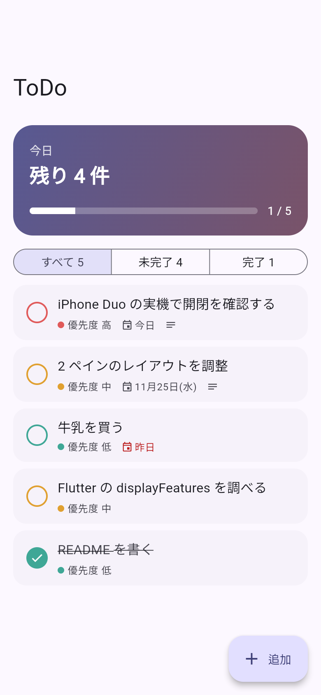
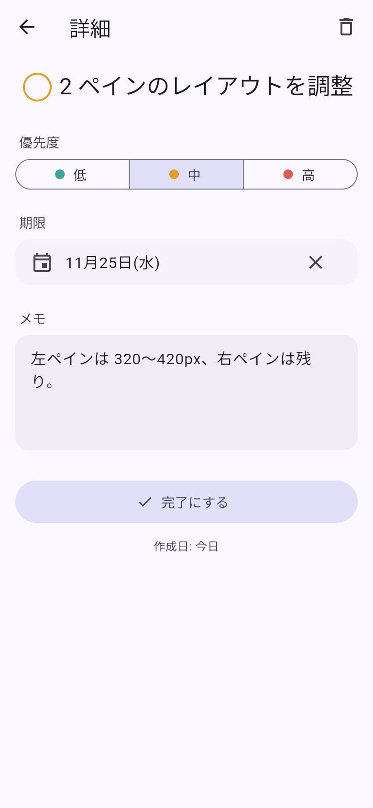
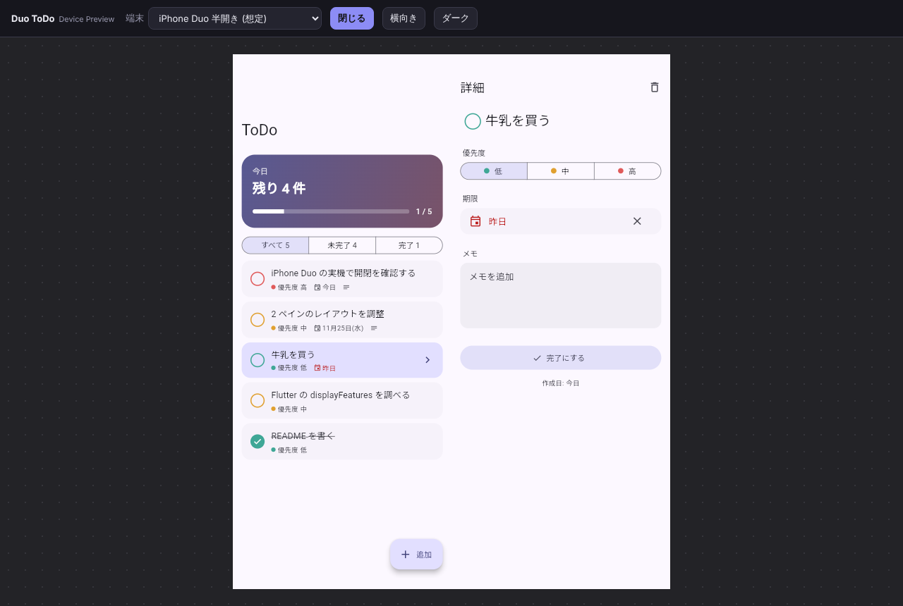

# sample_duo_app

iPhone Duo (折りたたみ iPhone) に対応した Flutter の ToDo アプリ。
折りたたみ端末対応のプラクティス用サンプルです。

| 閉じた状態 (一覧) | 閉じた状態 (詳細) | 開いた状態 (2 ペイン) |
| --- | --- | --- |
|  |  |  |

## 機能

- ToDo の追加 (ボトムシート) / 編集 / 完了切り替え / 削除 (スワイプ・元に戻す)
- 優先度・期限・メモ、期限切れの強調表示
- すべて / 未完了 / 完了 のフィルタと進捗表示
- ライト / ダークテーマ (Material 3)

## iPhone Duo 対応の考え方

`lib/layout/duo_layout.dart` にまとめています。

| 状態 | レイアウト |
| --- | --- |
| 閉じた状態 (外側ディスプレイ) / 通常の iPhone | 1 ペイン。一覧 → タップで詳細を push |
| 開いた状態 (内側ディスプレイ) / iPad / 横向き | 2 ペイン。左に一覧、右に詳細 |

1. **幅ベースで判定する** — 幅 600dp 以上で 2 ペイン (Material 3 の window size class)。
   2026 年 11 月時点で Flutter は iOS のヒンジ情報 (`MediaQuery.displayFeatures`) を返さないため、
   iPhone Duo ではこれが実質的な判定方法になります。
2. **ヒンジ情報があれば優先する** — Android の折りたたみ端末などで縦のヒンジ / 半開きの折り目が
   報告された場合は、その位置でペインを分割してヒンジをまたがないようにしています。
   将来 iOS でも値が入るようになればそのまま効きます。
3. **開閉で状態を引き継ぐ (App Continuity)** — `TodoHomePage` がモードの変化を検知し、
   - 閉じた状態で詳細を見ていた → 開くと詳細の route を閉じて右ペインに表示
   - 開いた状態で選択していた → 閉じると詳細画面を push
   一覧は `GlobalKey` でツリー上の位置が変わってもスクロール位置などを保持します。

## 状態管理

グローバルな状態管理ライブラリは使わず、`StatefulWidget` + `setState` のみ。
ToDo のリストと選択状態は `TodoHomePage` の `State` が持ち、子ウィジェットには値とコールバックを渡しています。

## 構成

```
lib/
  main.dart                    アプリのエントリーポイント
  app_theme.dart               テーマ (ライト / ダーク)
  layout/duo_layout.dart       1 / 2 ペイン判定と DualPane ウィジェット
  models/todo.dart             Todo モデル / Priority / TodoFilter
  models/sample_todos.dart     初期データ
  pages/todo_home_page.dart    状態を持つルート画面 (開閉時の引き継ぎもここ)
  widgets/                     一覧・詳細・追加シートなどの UI
  utils/date_format.dart       日本語の日付表示
test/todo_app_test.dart        1 / 2 ペイン、開閉の引き継ぎ、ヒンジ判定のテスト
test_vrt/vrt_test.dart         VRT 用スクリーンショットの撮影
tool/vrt/                      Pages 用 VRT レポート (reg-cli) の生成
```

## Web 版 (GitHub Pages) と端末プレビュー

Web 版は GitHub Pages に公開しています (後述の「CI / GitHub Pages / VRT」を参照)
(`https://<user>.github.io/sample_duo_app/`)。

Web 版だけ [device_preview](https://pub.dev/packages/device_preview) を有効にしていて、
画面上部のツールバーから端末を切り替えてレスポンシブ表示を確認できます。

| 閉じた状態 (iPhone 17 相当) | 半開き (折り目で 2 ペインに分割) |
| --- | --- |
|  |  |

- **開く / 閉じる**: iPhone Duo の開閉を切り替えます。アプリの状態は保たれたままなので、
  選択中の ToDo が引き継がれる様子をそのまま確認できます。
- **端末**: iPhone Duo (閉 / 開 / 半開き)、iPhone SE、iPhone 17 Pro Max、iPad mini、
  Galaxy Z Fold8、Pixel 10 Pro Fold、プレビュー解除 (ブラウザ幅)
- **横向き / ダーク**: 回転とダークモード

device_preview に iPhone Duo のプリセットはまだ無いため、開いた状態は 800×980 の
**想定サイズ**で定義しています (`lib/preview/preview_devices.dart`)。実機の値が分かったら差し替えてください。

仕組み:

- `lib/main.dart` で条件付き import を使い、Web のときだけ `lib/preview/web_preview_bridge.dart` を読み込みます。
  iOS / Android ではスタブが使われ、device_preview はビルドに含まれません。
- device_preview 3.x はアプリ内のツールバーが無く、操作 UI は DevTools 側にあります。Pages では DevTools を
  使えないため、`web/index.html` に HTML のツールバーを置き、JS 経由で `DevicePreview.controller` を操作しています。
- device_preview 3.0.0 は Flutter 3.50 の Web ビルドでコンパイルエラーになるため、
  1 メソッド追加したコピーを `third_party/device_preview` に置いて `dependency_overrides` で使っています
  (詳細は `third_party/device_preview/PATCHED.md`)。

## CI / GitHub Pages / VRT

| ワークフロー | タイミング | 内容 |
| --- | --- | --- |
| `.github/workflows/ci.yml` | PR / main への push | analyze・test・Web ビルド、VRT (スクリーンショット撮影 → [reg-actions](https://github.com/reg-viz/reg-actions) で比較・PR コメント) |
| `.github/workflows/pages.yml` | CI 完了後 (`workflow_run`) | Web 版と VRT レポート (reg-cli) をまとめて GitHub Pages に公開 |

公開される URL:

- `https://<user>.github.io/sample_duo_app/` … Web 版 (端末プレビュー付き)
- `https://<user>.github.io/sample_duo_app/vrt/` … VRT レポート一覧
  - `vrt/main/` … main のスクリーンショット一覧
  - `vrt/pr-<番号>/` … PR ごとの差分レポート (PR が閉じられると次の公開時に削除)

Action はすべてコミット SHA で固定しています (`uses: owner/action@<sha> # vX.Y.Z`)。

### VRT (Visual Regression Test) の仕組み

reg-suit と同じ reg-viz の [reg-actions](https://github.com/reg-viz/reg-actions) を使っています。
外部ストレージ (S3 / GCS) や GitHub App は不要で、GitHub Actions のアーティファクトだけで動きます。

1. `test_vrt/vrt_test.dart` が `flutter test` 上でアプリを端末サイズごとに描画し、
   `test_vrt/screenshots/*.png` に書き出す (閉じた状態・開いた状態・半開き・ダーク・タブレットなど)。
   日本語は CI で入れた Noto Sans CJK で描画する。
2. reg-actions がスクリーンショットをアーティファクト `reg` として保存する。
   main への push で保存されたものが、以降の PR の比較対象になる。
3. PR では、分岐元 (merge-base) のコミットの `reg` と比較する (main が先に進んでも無関係な差分が出ない)。
   差分があれば **画像付きで PR にコメント**する。コメントは 1 件で、push のたびに更新され、
   差分が無くなると resolved 表示になる。コメント用の画像は `reg_actions` ブランチに push される。
4. `pages.yml` が `reg` アーティファクトから PNG だけを取り出し、main のコードで
   reg-cli のレポート (`tool/vrt/build_report.sh`) を作り直して Pages に公開する
   (PR のコードが作った HTML は載せない)。PR コメントの「レポート」リンクはこのページを指す。
   Pages はデプロイのたびにサイト全体が置き換わるので、開いている PR のレポートは
   前回のアーティファクト `vrt-site` から引き継ぐ。

差分があっても CI は失敗にしていません (マージはブロックしない方針)。

ローカルで試す (レポートの生成だけ):

```sh
VRT_CJK_FONT=/path/to/NotoSansCJK-Regular.ttc flutter test test_vrt
npm ci --prefix tool/vrt
mkdir -p build/vrt-src && cp -r test_vrt/screenshots build/vrt-src/1_actual
tool/vrt/build_report.sh build/vrt-src build/vrt-report --gallery   # build/vrt-report/index.html
```

フォントや OS が違うと描画も少し変わるので、比較は CI 上で行う前提です。

### GitHub Pages の初回設定

リポジトリの **Settings → Pages → Build and deployment → Source** を **GitHub Actions** にしてください。

## 実行

```sh
flutter pub get
flutter run          # iPhone Duo シミュレータで開閉を切り替えて確認
flutter test
flutter run -d chrome   # Web 版 (端末プレビュー付き)
```

テストでは画面サイズを変えて「閉じた状態 (390×844)」と「開いた状態 (900×760)」を再現しています。
