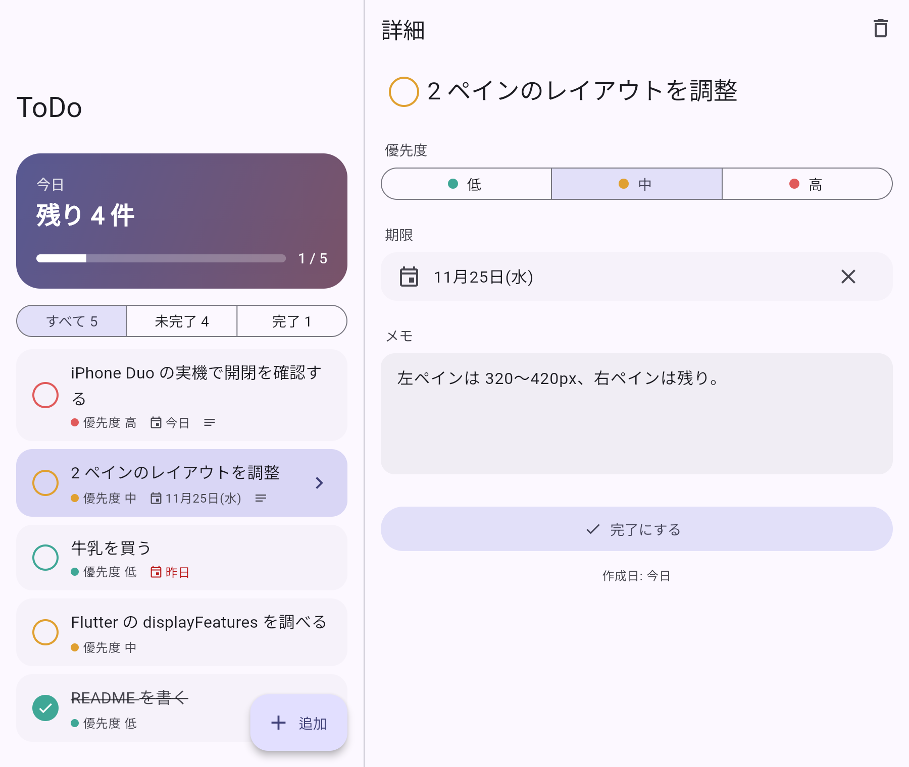

# sample_duo_app

iPhone Duo (折りたたみ iPhone) に対応した Flutter の ToDo アプリ。
折りたたみ端末対応のプラクティス用サンプルです。

| 閉じた状態 (一覧) | 閉じた状態 (詳細) | 開いた状態 (2 ペイン) |
| --- | --- | --- |
|  |  |  |

## 機能

- ToDo の追加 (ボトムシート) / 編集 / 完了切り替え / 削除 (スワイプ・元に戻す)
- 優先度・期限・メモ、期限切れの強調表示
- すべて / 未完了 / 完了 のフィルタと進捗表示
- ライト / ダークテーマ (Material 3)

## iPhone Duo 対応の考え方

`lib/layout/duo_layout.dart` にまとめています。

| 状態 | レイアウト |
| --- | --- |
| 閉じた状態 (外側ディスプレイ) / 通常の iPhone | 1 ペイン。一覧 → タップで詳細を push |
| 開いた状態 (内側ディスプレイ) / iPad / 横向き | 2 ペイン。左に一覧、右に詳細 |

1. **幅ベースで判定する** — 幅 600dp 以上で 2 ペイン (Material 3 の window size class)。
   2026 年 11 月時点で Flutter は iOS のヒンジ情報 (`MediaQuery.displayFeatures`) を返さないため、
   iPhone Duo ではこれが実質的な判定方法になります。
2. **ヒンジ情報があれば優先する** — Android の折りたたみ端末などで縦のヒンジ / 半開きの折り目が
   報告された場合は、その位置でペインを分割してヒンジをまたがないようにしています。
   将来 iOS でも値が入るようになればそのまま効きます。
3. **開閉で状態を引き継ぐ (App Continuity)** — `TodoHomePage` がモードの変化を検知し、
   - 閉じた状態で詳細を見ていた → 開くと詳細の route を閉じて右ペインに表示
   - 開いた状態で選択していた → 閉じると詳細画面を push
   一覧は `GlobalKey` でツリー上の位置が変わってもスクロール位置などを保持します。

## 状態管理

グローバルな状態管理ライブラリは使わず、`StatefulWidget` + `setState` のみ。
ToDo のリストと選択状態は `TodoHomePage` の `State` が持ち、子ウィジェットには値とコールバックを渡しています。

## 構成

```
lib/
  main.dart                    アプリのエントリーポイント
  app_theme.dart               テーマ (ライト / ダーク)
  layout/duo_layout.dart       1 / 2 ペイン判定と DualPane ウィジェット
  models/todo.dart             Todo モデル / Priority / TodoFilter
  models/sample_todos.dart     初期データ
  pages/todo_home_page.dart    状態を持つルート画面 (開閉時の引き継ぎもここ)
  widgets/                     一覧・詳細・追加シートなどの UI
  utils/date_format.dart       日本語の日付表示
test/todo_app_test.dart        1 / 2 ペイン、開閉の引き継ぎ、ヒンジ判定のテスト
```

## 実行

```sh
flutter pub get
flutter run          # iPhone Duo シミュレータで開閉を切り替えて確認
flutter test
```

テストでは画面サイズを変えて「閉じた状態 (390×844)」と「開いた状態 (900×760)」を再現しています。
